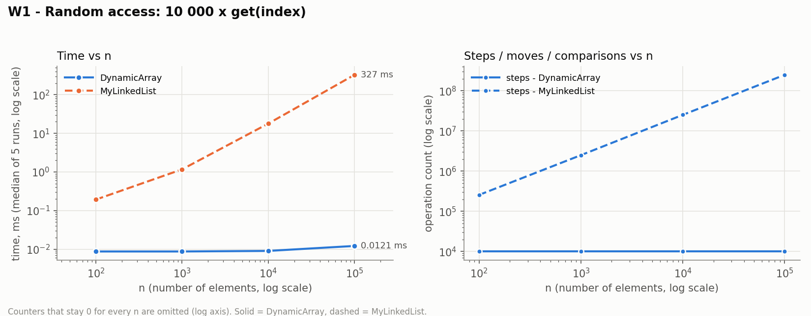
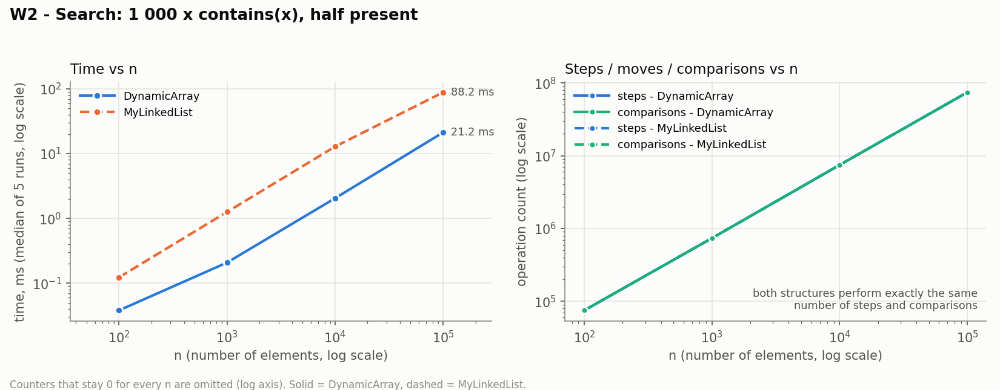
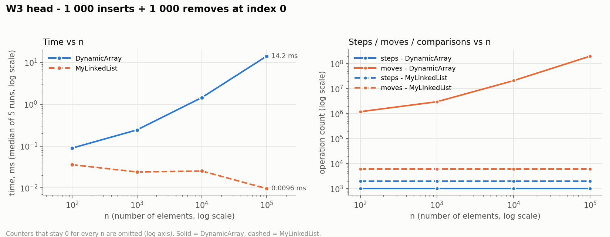
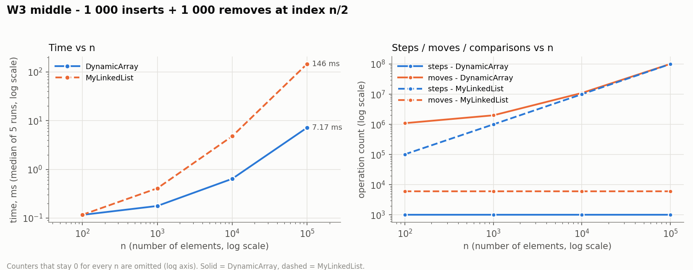
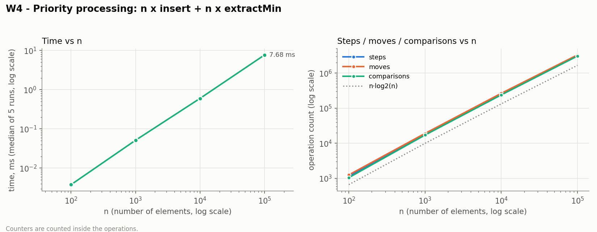
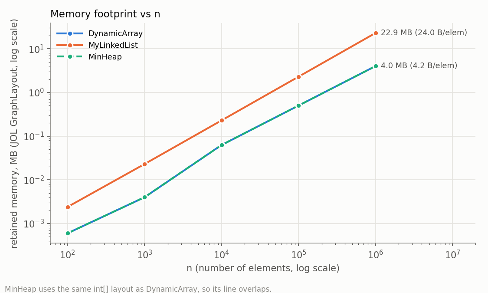
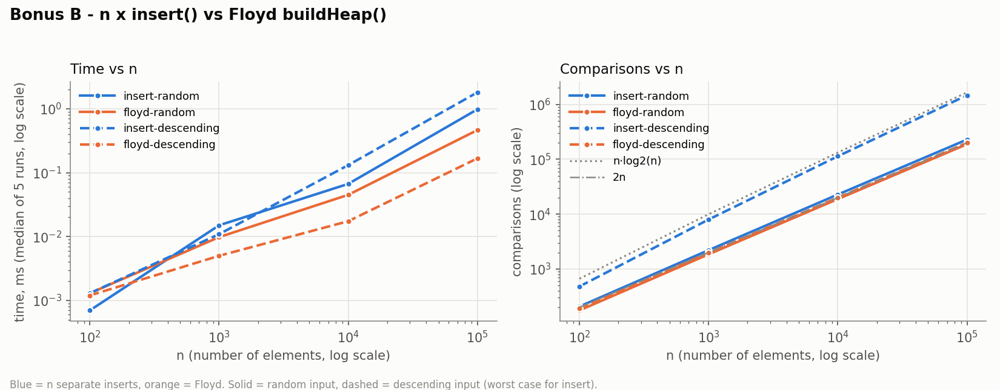

# Assignment 2 - Data Structures: Report

**Student:** Darkhan Tynyshtyk · **Group:** _(fill in)_ · **Course:** Design and Analysis of Algorithms

**Environment:** Apple M3 (8 GB RAM), macOS, OpenJDK 25.0.1 (HotSpot, compressed oops), heap `-Xms1g -Xmx1g`.
**Method:** input from `new Random(42)`; a discarded warm-up pass over n = 100, 1 000, 10 000, then per case
5 discarded warm-up runs and 5 measured runs; the **median** time is reported. Only the measured phase is
timed (filling the list before W1-W3 is not). Counters are incremented inside the operations and are identical
in all 5 runs, and the runner checks this.

## 1. Implementations

| Structure | Storage | Key design decisions |
|-----------|---------|----------------------|
| `DynamicArray` | `int[] data`, `size` | capacity doubles when full (8 → 16 → 32 ...); shifts are explicit loops so each shifted element is counted as a move |
| `MyLinkedList` | doubly linked `Node{int value; Node prev, next}`, `head`, `tail` | `add(x)` is O(1) thanks to `tail`; index operations walk from the **nearer** end |
| `MinHeap` | `int[] heap`, `size`; children of `i` are `2i+1`, `2i+2` | `insert` = bubble-up, `extractMin` = last leaf to root + bubble-down; `buildHeap` = Floyd |

Both lists implement the same interface `IntList`, so one benchmark method runs both. Invalid indices throw
`IndexOutOfBoundsException`; `peekMin`/`extractMin` on an empty heap throw `IllegalStateException`.

## 2. Asymptotic analysis

n = number of stored elements. "Average" means a uniformly random index or a uniformly random present value.

| Operation | Best | Average | Worst | Aux. space | Justification |
|-----------|------|---------|-------|-----------|---------------|
| **DynamicArray** `add(x)` | Θ(1) | Θ(1) amortized | Θ(n) | Θ(1); Θ(n) on resize | Free slot: one write. On resize, n elements are copied, but resizes happen at sizes 1, 2, 4, ..., so the total copying over n adds is < 2n (test: 1024 adds → 1023 moves) |
| `add(index, x)` | Θ(1) | Θ(n) | Θ(n) | Θ(1) | Shifts `size - index` elements: 0 at the end, n/2 on average, n at index 0 |
| `remove(index)` | Θ(1) | Θ(n) | Θ(n) | Θ(1) | Shifts `size - 1 - index` elements: 0 for the last index, n − 1 for index 0 |
| `get(index)` | Θ(1) | Θ(1) | Θ(1) | Θ(1) | Address = base + 4·index, exactly one cell read |
| `contains(x)` | Θ(1) | Θ(n) | Θ(n) | Θ(1) | Linear scan; stops at the first match (best: position 0), n reads when absent |
| Storage | | | | Θ(n) | `4·capacity + 16` bytes, n ≤ capacity < 2n after growth (capacity never shrinks) |
| **MyLinkedList** `add(x)` | Θ(1) | Θ(1) | Θ(1) | Θ(1) | Uses `tail`; 3 link updates, never a walk |
| `add(index, x)` | Θ(1) | Θ(n) | Θ(n) | Θ(1) | Walk `min(i, n−i)` nodes (n/4 on average, n/2 at the middle) + 4 link updates; Θ(1) near either end |
| `remove(index)` | Θ(1) | Θ(n) | Θ(n) | Θ(1) | Same walk + 2 link updates; no element is shifted |
| `get(index)` | Θ(1) | Θ(n) | Θ(n) | Θ(1) | `min(i, n−1−i) + 1` steps: 1 at the ends, about n/2 in the middle |
| `contains(x)` | Θ(1) | Θ(n) | Θ(n) | Θ(1) | Same linear scan as the array, one node per step |
| Storage | | | | Θ(n) | 24 bytes per node (JOL), about 6 times the array |
| **MinHeap** `insert(x)` | Θ(1) | Θ(1) on random input | Θ(log n) (Θ(n) on resize) | Θ(1) | Bubble-up stops when `parent ≤ x`; a new minimum climbs all ⌊log₂ n⌋ levels. Random input: 2.29 comparisons per insert (measured, n = 10⁵) |
| `peekMin()` | Θ(1) | Θ(1) | Θ(1) | Θ(1) | Minimum is always `heap[0]` |
| `extractMin()` | Θ(1) | Θ(log n) | Θ(log n) | Θ(1) | The last leaf moved to the root is usually large and sinks almost to the bottom; best case: it is already ≤ both children (e.g. all keys equal) |
| `buildHeap(a)` (Floyd) | Θ(n) | Θ(n) | Θ(n) | Θ(n) copy | Σ over heights h of (n/2^(h+1))·O(h) = O(n); at least n/2 sift-down calls, so Ω(n) |
| Storage | | | | Θ(n) | Same `int[]` layout as `DynamicArray` |

## 3. Loop-invariant proofs

### 3.1 `DynamicArray.contains(x)`

```java
for (int i = 0; i < size; i++) {
    if (data[i] == x) return true;
}
return false;
```

- **Invariant.** At the start of the iteration with index i (0 ≤ i ≤ size), x is not in `data[0..i−1]`.
- **Initialization.** Before the first iteration i = 0, and `data[0..−1]` is empty, so the statement is true.
- **Maintenance.** Assume x ∉ `data[0..i−1]` and the loop body runs (so i < size). If `data[i] == x`, the method
  returns `true`, which is correct because `data[i]` is a stored element (0 ≤ i < size). Otherwise
  `data[i] ≠ x`, so x ∉ `data[0..i]`. After `i++` the invariant holds for the new i.
- **Termination.** i grows by 1 from 0 and `size` does not change, so the loop stops after at most `size`
  iterations. If it stops because i = size, the invariant gives x ∉ `data[0..size−1]`, which is the whole list.
- **Conclusion.** The method returns `true` only when it has found a cell equal to x, and returns
  `false` only when the invariant shows x is in no cell. So `contains` is correct. The same proof works for
  `MyLinkedList.contains`, with "the first i nodes" in place of `data[0..i−1]`.

### 3.2 `MinHeap.siftDown(i)` (bubble-down, used by `extractMin` and `buildHeap`)

```java
int x = heap[i];
while (true) {
    int left = 2 * i + 1;
    if (left >= size) break;
    int smallest = left, s = heap[left];
    if (left + 1 < size && heap[left + 1] < s) { smallest = left + 1; s = heap[left + 1]; }
    if (x <= s) break;
    heap[i] = s; heap[smallest] = x;      // swap
    i = smallest;
}
```

**Precondition** (start index r): inside the subtree T(r) every parent–child pair (p, c) has
`heap[p] ≤ heap[c]`, except possibly the pairs with p = r.

- **Invariant.** Before each iteration, with current index i:
  (a) `heap[i] = x`;
  (b) every parent–child pair (p, c) in T(r) with p ≠ i satisfies `heap[p] ≤ heap[c]`;
  (c) if i ≠ r, then `heap[parent(i)] ≤ heap[c]` for every child c of i;
  (d) the array holds the same values as before the call, because the loop only swaps.
- **Initialization.** i = r. (a) holds by the first line. (b) is the precondition. (c) holds vacuously
  because i = r. (d) is trivially true.
- **Maintenance.** Assume the loop does not exit, so i has a child and x > s, where s = `heap[smallest]` is the
  smaller child. After the swap, `heap[i] = s` and `heap[smallest] = x`, and i becomes `smallest`. Check the
  pairs that changed:
  pair (i, smallest): s < x ✓.
  Pair (i, other child o): s ≤ `heap[o]` because s is the minimum child ✓.
  Pair (parent(i), i) when i ≠ r: by (c), `heap[parent(i)] ≤ heap[smallest]` = s ✓.
  Pairs (smallest, c) now have p equal to the new i, so (b) allows them.
  All other pairs are unchanged ✓.
  For (c) at the new i = smallest: its parent now holds s, and before the swap (b) gave s ≤ `heap[c]` for the
  children c of `smallest`. Those children did not change ✓. (a) holds because x was written to `heap[smallest]`.
  (d) holds because a swap preserves the values.
- **Termination.** `smallest ≥ 2i + 1 > i`, so i strictly increases and is bounded by `size`. The loop
  makes at most ⌊log₂ size⌋ iterations. It exits in one of two ways. (1) `left ≥ size`: i is a leaf, so no
  pair has p = i, and (b) says every pair in T(r) is ordered. (2) `x ≤ s`: `heap[i]` = x is at most both
  children, so the pairs with p = i are ordered too. In both cases T(r) is a valid min-heap with the same values (d).
- **Conclusion.** In `extractMin`, the old root is the minimum of a valid heap, so returning it is correct.
  Moving the last leaf to index 0 can break only the pairs (0, c), which is the precondition with r = 0, so
  after the loop the whole array is a heap again. In `buildHeap`, i goes from ⌊n/2⌋−1 down to 0, so both child
  subtrees are already heaps when i is processed. That is the precondition, and after i = 0 the whole array is a heap.

## 4. Results

All charts use log-log axes. **Left:** median time, both structures on one chart. **Right:** counted
steps/moves/comparisons. Full numbers: `results/results.csv`. Values below 0.1 ms can differ by a factor of 2-3
between separate benchmark runs (timer resolution and JIT noise). The trends are stable from n = 1 000 up.

### W1 - Random access (10 000 × `get`)


The array performs exactly 10 000 steps for every n, and its time is flat at 0.009-0.012 ms. The list needs
about n/4 hops per `get` (2.49·10⁸ steps at n = 10⁵), so its time grows linearly to 327 ms. That is
**27 000 times** slower than the array at n = 10⁵.

### W2 - Search (1 000 × `contains`, 500 hits / 500 misses)


Both structures perform **exactly the same** number of steps and comparisons (7.43·10⁷ at n = 10⁵), because
both scan from the front. Even so, the list is **3-6 times slower**: 1.2-1.7 ns per step against 0.27-0.29 ns
per step for the array (n ≥ 1 000).

### W3 - Insert & remove at head / middle (1 000 + 1 000 operations)



**Head:** the array shifts the whole array on every operation (2.0·10⁸ moves at n = 10⁵, 14.2 ms). The list
does 1 step and 4 or 2 link updates per operation (6 000 moves in total, 0.01 ms), so it is **about 1 500 times
faster**, and its cost does not depend on n.
**Middle:** both structures do about 10⁸ elementary operations at n = 10⁵: the array has 1.0·10⁸ moves (shifts)
and the list has 1.0·10⁸ steps (walk to n/2). The array still wins **20 times** (7.2 ms vs 145.7 ms), because
one shifted element costs 0.07 ns and one hop costs 1.46 ns. At n = 100 the two structures are equal (0.12 ms).

### W4 - Priority processing (n × `insert`, n × `extractMin`)


For every n, the output of the n `extractMin` calls was checked to be non-decreasing. The comparison count
follows `c·n·log₂ n` with c = 1.58 → 1.84 as n grows, and time grows from 0.004 ms to 7.7 ms. `insert` is
cheap on random data (about 2.3 comparisons each), so almost all of the cost is the sift-down in
`extractMin`. Sift-down makes up to 2 comparisons per level over about log₂ n levels.

## 5. Discussion: why equal Big-O gives different real time

1. `DynamicArray.get(i)` is one address calculation and one load, while `MyLinkedList.get(i)` must load
   about n/4 nodes one after another. W1 shows that difference as a factor of 27 000 at n = 10⁵.
2. Even for a plain scan, where both structures are Θ(n) and do the same number of steps (W2), the array is
   3-6 times faster, because of how memory is fetched.
3. The CPU loads memory in 64-byte cache lines. One line holds 16 consecutive `int`s, so a scan of the
   array uses every byte it fetches (spatial locality).
4. The hardware prefetcher recognises the sequential pattern and loads the next lines before they are needed.
   The JIT can also unroll and vectorise the loop, which is why one shifted element in W3 costs only 0.07 ns.
5. A list node is 24 bytes (12-byte object header + 4-byte value + two 4-byte references), so a cache line holds
   only 2.67 elements. Six times more memory has to pass through the caches for the same data (see Bonus A).
6. The main problem is **pointer chasing**: the address of node k+1 is known only after node k has been
   loaded. The loads form a dependency chain, and the CPU cannot overlap them as it does for an array index.
7. In the benchmark the nodes were allocated one after another, so they lie at a regular 24-byte stride. The
   M3's prefetchers can partly predict that pattern, which is likely why some list runs cost under 1 ns per hop.
8. In a long-running program, nodes are created at different times and moved by the garbage collector, so they
   scatter across the heap and every hop risks a cache miss, which costs on the order of 100 ns when it goes to main memory.
9. Every node is also a separate object that the garbage collector must allocate, trace and copy. The array is
   a single object whose `int`s the collector never inspects.
10. `Integer` instead of `int` would add another pointer and another 16-byte object per element, so the array
    would lose its locality too. That is why all structures store primitive `int`.
11. **MyLinkedList is the better choice** when insertions and removals happen at the ends, or at a position
    already reached by an iterator or node reference. W3 head is about 1 500 times faster than the array and
    does not depend on n. The list also never copies the whole structure during a resize, so its worst-case
    latency per operation is predictable.
12. The list is a poor choice for indexed access and for "find the position first" workloads, because the walk
    dominates (W3 middle).
13. **MinHeap is the right choice** when only the smallest element is repeatedly needed (job scheduling,
    Dijkstra, event simulation). It gives Θ(1) `peekMin` and Θ(log n) `insert`/`extractMin`, against Θ(n) for
    finding the minimum in an unsorted list or Θ(n) shifts for keeping an array sorted.
14. The heap also keeps the cache benefits of the array, because it is stored in one contiguous `int[]`.

## 6. Bonus A - Memory footprint (JOL)



`GraphLayout.parseInstance(...).totalSize()` counts every object reachable from the structure.

| n | DynamicArray | DynamicArray (exact capacity) | MyLinkedList | MinHeap |
|---|---|---|---|---|
| 10⁴ | 65 616 B (6.56 B/elem) | 40 080 B (4.01) | 240 072 B (24.01) | 65 616 B (6.56) |
| 10⁵ | 524 368 B (5.24) | 400 080 B (4.00) | 2 400 072 B (24.00) | 524 368 B (5.24) |
| 10⁶ | 4.00 MB (4.19) | 3.81 MB (4.00) | 22.89 MB (24.00) | 4.00 MB (4.19) |

JOL prints the following `Node` layout: 8-byte mark word + 4-byte compressed class pointer + `int value` (4) +
`prev` (4) + `next` (4) = **24 bytes**. The `int` payload is only 4 of them (17 %), and the other 20 bytes are
overhead.

An `int[]` costs a 16-byte header once, plus 4 bytes per slot. With 2× growth, the unused capacity costs at most
another 4 bytes per element (between 4 and 8 B/elem, e.g. 5.24 at n = 10⁵, where capacity is 131 072).

Alignment matters too. A singly linked node would have 12 + 4 + 4 = 20 bytes, which is padded to the 8-byte
boundary, so it would *also* take 24 bytes and save nothing. With heaps above 32 GB (no compressed
references), the doubly linked node would grow to 16 + 4 + 8 + 8 = 36 bytes, padded to 40.

## 7. Bonus B - Floyd's O(n) `buildHeap`



| n = 10⁵ | comparisons | moves | time, ms |
|---|---|---|---|
| n × `insert`, random input | 228 896 | 257 820 | 0.98 |
| Floyd `buildHeap`, random input | 188 488 | 149 330 | 0.46 |
| n × `insert`, descending input | 1 468 946 | 2 937 892 | 1.81 |
| Floyd `buildHeap`, descending input | 199 978 | 199 980 | 0.17 |

Floyd's method sifts **down** from the last internal node. About n/2 nodes are leaves and need no work,
n/4 nodes can sink at most 1 level, n/8 at most 2, and so on. The total is n·Σ h/2^(h+1) ≤ n levels, so at
most about 2n comparisons. The measured count was 1.76n-2.0n for every n.

n separate inserts sift **up**, and the cost depends on the input. On descending input every new key is a new
minimum and climbs the full depth, so the cost is Θ(n log n): 1.47·10⁶ comparisons, which is 7.3 times as many
and takes 10.8 times as long. On random input most new keys stop after one or two levels (the expected cost of
an insert is O(1)), so the gap shrinks to 1.2 times in comparisons. Floyd is still 2 times faster in time,
because it does 42 % fewer moves and runs one tight loop over the array.

## 8. Testing

87 JUnit 5 tests (`./mvnw test`) cover the following:
- **Correctness:** 20 000 random mixed operations compared with `java.util.ArrayList` (3 seeds, both lists),
  heap compared with `PriorityQueue`, and sorted output compared with `Arrays.sort`.
- **Edge cases:** empty structure, one element, duplicates, `Integer.MIN_VALUE`/`MAX_VALUE`, first and last
  index, invalid indices (−1, size, `Integer.MIN_VALUE`/`MAX_VALUE`), and reuse after emptying.
- **Heap property:** `a[parent] ≤ a[child]` is checked after every `insert` and every `extractMin`.
- **Sorted output:** n `extractMin` calls return non-decreasing values for n up to 50 000, and the
  same holds after `buildHeap`.
- **Counters:** `get` costs 1 step in the array and `min(i, n−1−i) + 1` in the list; 2× growth gives
  1023 moves for 1024 adds; W2 step counts are equal for both lists; W3 never reports zero moves.
